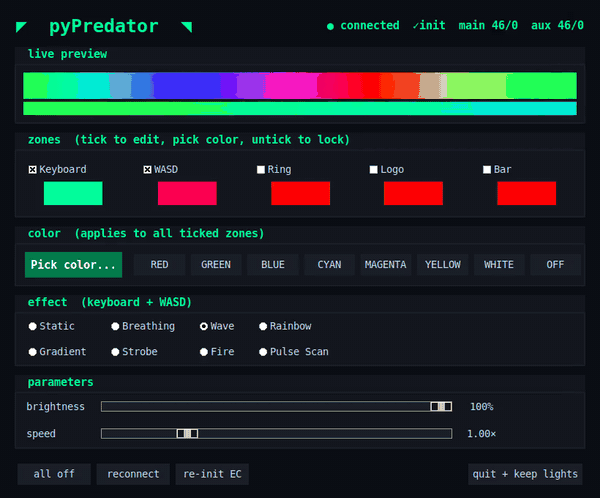
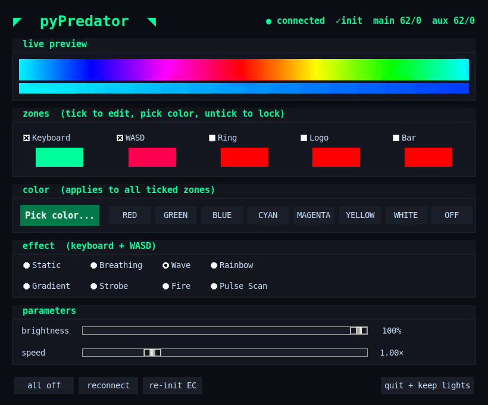

# pyPredator

[](https://github.com/ahuou/rgb_predator_PH18_73/actions/workflows/tests.yml)

Linux replacement for Acer PredatorSense RGB keyboard control on the **Predator PH18-73**.
One Python file, one dependency (`pyusb`), protocol reverse-engineered from USB captures.



*The real GUI and effect engine, recorded headless with the USB layer stubbed out
(see [tools/headless_demo.py](tools/headless_demo.py)). The live-preview strips show the
exact 128 + 16 pixel frames that are streamed to the keyboard at 30 Hz.*

Controls three lighting systems from a single GUI:
- **Main keyboard** (128-pixel per-key RGB via USB HID)
- **WASD / gaming keys** (16-pixel aux zone via USB HID)
- **Infinity ring, cover logo, underglow bar** (via the [acer_PH18-73_rgb CLI by linuxbest](https://github.com/linuxbest/acer_PH18-73_rgb), MIT, included as a git submodule; pyPredator only shells out to it)

## Quick start

```bash
# 1. Clone (with submodule for ring/logo/bar support)
git clone --recurse-submodules https://github.com/ahuou/rgb_predator_PH18_73.git
cd rgb_predator_PH18_73

# 2. Install dependencies
pip install pyusb
# or: sudo apt install python3-usb libusb-1.0-0

# 3. One-time setup (installs udev rule so you don't need sudo)
python3 pypredator.py --setup

# 4. Run
python3 pypredator.py
```

If you forgot `--recurse-submodules` during clone:
```bash
git submodule update --init
```

## What `--setup` does

Installs a udev rule to `/etc/udev/rules.d/99-predator-rgb.rules` that:
- Grants non-root access to the keyboard USB device (`05af:867b`)
- Auto-unbinds usbhid from interfaces 1 and 3 (RGB data channels) at plug-in time

This is required once per machine. It will ask for your sudo password.

## Safety

This script has been carefully designed to **never interfere with your typing keyboard**:

- **Interface 0 (typing keyboard) is never detached.** The code only touches USB interfaces 1 (bulk pixel data) and 3 (control reports). Interface 0 is explicitly protected throughout: the udev rule, the detach logic, and the HID dump command all skip it.
- **No `dev.reset()`.** Earlier versions used USB device reset as a fallback, which could momentarily kill all keyboard input. This has been removed.
- **No `set_auto_detach_kernel_driver()`.** This libusb feature would silently detach interface 0 when claiming other interfaces. It is intentionally not used.
- **Crash cleanup via `atexit`.** If the script crashes, an exit handler releases USB interfaces and re-attaches the kernel driver so nothing is left in a broken state.
- **Clean disconnect.** When the script exits normally, it releases interfaces and re-attaches the kernel HID driver, restoring the device to its pre-launch state.

**If something ever goes wrong** and your keyboard stops responding:
1. Unplug and replug the laptop's USB keyboard (or close and reopen the laptop lid)
2. Or run: `sudo modprobe -r usbhid && sudo modprobe usbhid`

## Usage

```
python3 pypredator.py              # launch GUI
python3 pypredator.py --setup      # install udev rule + check deps
python3 pypredator.py --stop       # kill background daemon
python3 pypredator.py --dump-hid   # dump HID report descriptors (debug)
```

### GUI features



- **Effect modes:** Static, Breathing, Wave, Rainbow, Gradient, Strobe, Fire, Pulse Scan
- **Separate WASD color:** Uncheck "sync WASD with main" to set an independent WASD color
- **Color presets:** One-click RED, GREEN, BLUE, CYAN, MAGENTA, YELLOW, WHITE, OFF
- **Brightness and speed** sliders
- **System lights** (ring/logo/bar): requires the `acer_PH18-73_rgb` submodule
- **Quit + keep lights:** Forks a background daemon that keeps streaming so your keyboard doesn't revert to the default rainbow

## Requirements

- Ubuntu (tested on 24.04+) or similar Linux
- Python 3.10+
- `pyusb` (`pip install pyusb`) or `python3-usb` apt package
- `libusb-1.0-0` (usually already installed; `sudo apt install libusb-1.0-0` if not)
- Acer Predator PH18-73 with USB keyboard device `05af:867b`

## How it works

The PH18-73 keyboard exposes a USB HID device with 4 interfaces. pyPredator streams RGB frames at 30 Hz using the protocol reverse-engineered from PredatorSense USB captures:

```
CTRL  13 00 00 08 00 00 00 e4   (WASD zone begin)
BULK  1 x 64 bytes              (16 aux pixels as 00,R,G,B)
CTRL  12 00 00 08 00 00 00 e5   (main zone begin)
BULK  8 x 64 bytes              (128 main pixels as 00,R,G,B)
CTRL  08 02 b3 05 32 08 09 fa   (main commit)
CTRL  08 02 4f 05 32 08 01 66   (aux commit)
```

## Tests

The pure parts (checksums, bulk packet layout, every effect's frame shape) are covered by a
stdlib `unittest` suite that needs no USB device and no display:

```bash
python3 -m unittest discover -s tests -v
```

## History and credits

- **Original work (April 2026), Alex Huou.** Captured PredatorSense's USB traffic, worked out
  the 0x12/0x13 envelope + commit protocol and the init handshake, and wrote `pypredator.py`
  (USB layer, effect engine, Tk GUI, udev setup, keep-alive daemon) for his own PH18-73.
- **Ring, logo and underglow bar** control is the
  [acer_PH18-73_rgb](https://github.com/linuxbest/acer_PH18-73_rgb) CLI by linuxbest (MIT),
  used unmodified as a submodule.
- **Portfolio polish (October 2026, AI-assisted with Claude):** fixed the clone URL, added the
  headless GUI recording and its script, the hardware-free test suite, and this section.
  No change to `pypredator.py` itself. The recording uses a stub keyboard, so it shows the GUI
  and the frames, not the physical LEDs.

## License

MIT
